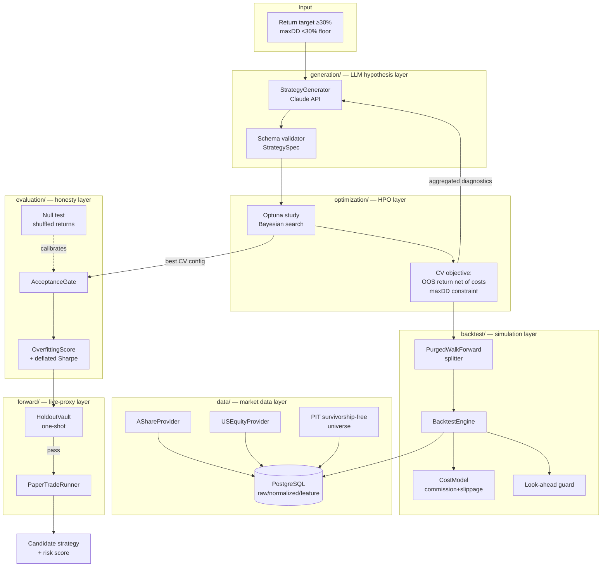
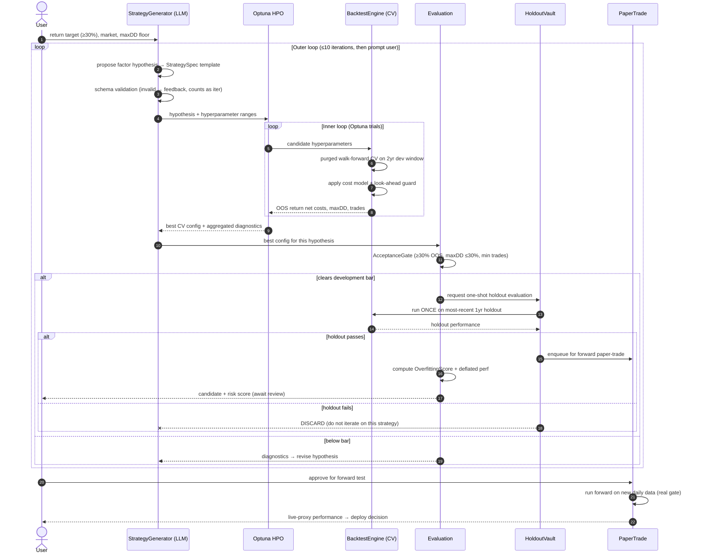
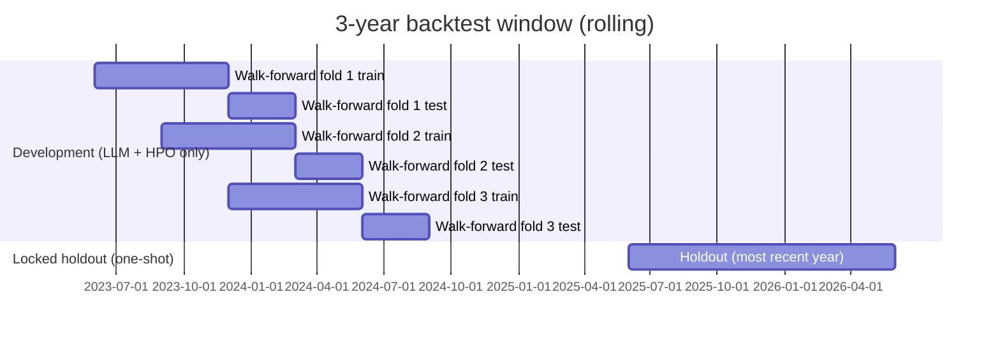

# AI Strategy-Generation Loop — Design Specification

Status: Draft for review · Date: 2026-06-27 · Owner: quant-agent-team

This document specifies the system that turns a return target into validated, linear multi-factor stock-selection strategies through an AI-driven hypothesis loop wrapped around hyperparameter optimization. It supersedes the auxiliary-KPI framing in [`solution-overview.md`](../../solution-overview.md) and refines the target architecture in [`current-architecture-draft.md`](../../current-architecture-draft.md).

---

## 1. Objectives & non-objectives

### 1.1 Objectives
1. **Generate high-return strategies.** Primary acceptance bar: **≥30% annualized return, net of costs, measured out-of-sample.** Doubling capital (~100% annualized) is a welcome-but-non-guaranteed stretch outcome, not an engineering target.
2. **Support two markets:** A-share and US equities, **price/volume data only** for this phase.
3. **Backtest on the recent past:** a **rolling 3-year window** only — no full-history backtests.

### 1.2 The one surviving constraint
All auxiliary performance KPIs (win-rate floors, Sharpe minimums, etc.) are **scrapped**. The single retained hard floor is **max drawdown ≤ 30%**, as a survivability guard against strategies that are mathematically certain to blow up.

### 1.3 Validity gates (NOT KPIs — non-negotiable correctness requirements)
These are not performance targets and cannot be configured away. They are what makes a reported number trustworthy:
- Transaction costs (commission + slippage), modeled, non-zero.
- Survivorship-free, point-in-time universe.
- No look-ahead / no data leakage.
- Minimum trade count for statistical meaningfulness.
- Strict separation of optimization data from validation data.

### 1.4 Non-objectives (this phase)
- No live order placement (signals only; human trades manually).
- No fundamental/event factors for US (price/volume only → technical factor set).
- No ML ranker (linear composite first; ML explicitly deferred to a later phase).
- No full-history backtesting.

---

## 2. Honest expectation-setting (read before the diagrams)

The mechanism at the heart of this system — searching over hypotheses and hyperparameters until something clears a return bar — is **the canonical way quant researchers fool themselves.** Every search trial leaks information from the data into the chosen strategy. Left unguarded, the loop will *reliably produce a number* that *does not survive live trading.*

The design therefore treats **overfitting as the primary adversary**, not a footnote. Three independent defenses, in increasing strength:

1. **Purged walk-forward cross-validation** during development — the optimizer is scored only on out-of-sample folds.
2. **A locked, one-shot holdout** — touched once per strategy; failure means discard, never iterate.
3. **Forward paper-trading** — the only true proof, since 3 years of history cannot validate a 30%+ magnitude claim.

A long-only, price/volume-only multi-factor book rarely clears 30% net by itself. The realistic levers to reach it — **concentration, higher turnover, small-cap tilt** — each raise risk and overfitting exposure. The system surfaces these tradeoffs rather than hiding them behind a headline return.

---

## 3. System architecture



### 3.1 Module responsibilities

| Module | Responsibility | Key change vs. today |
|---|---|---|
| `data/` | Fetch A-share + US price/volume; maintain point-in-time, survivorship-free universe | New `USEquityProvider` as primary (not yfinance fallback); new PIT universe; `market` discriminator added to `raw_market_daily` |
| `backtest/` | Deterministic simulation with costs, look-ahead guard, purged walk-forward splitter | Revamp of `backtest_runner.py`; mandatory non-zero `CostModel`; new `PurgedWalkForward` splitter |
| `optimization/` | Optuna HPO tuning hyperparameters against the CV objective | **New module** |
| `generation/` | LLM proposes factor hypotheses as schema-valid `StrategySpec` templates | **New module** |
| `evaluation/` | Acceptance gate, overfitting score, deflated performance, null test | Extends `evaluation.py`; thresholds sourced from request, not hardcoded |
| `forward/` | Locked holdout vault + forward paper-trading | **New module** |

---

## 4. End-to-end workflow



### 4.1 The 3-year window split



The development window (oldest ~2 years) is the *only* data the LLM and Optuna ever see. The most recent ~1 year is the locked holdout, reserved as the best available proxy for "what happens next." Walk-forward folds use **purging** (drop training samples whose label windows overlap a test fold) and an **embargo** (a gap after each test fold) to prevent leakage.

---

## 5. Detailed technical design

### 5.1 Strategy representation (`generation/`, `models.py`)

A strategy decomposes into a **hypothesis** (LLM-owned, qualitative) and **hyperparameters** (HPO-owned, numeric).

```python
@dataclass
class FactorHypothesis:
    market: Literal["cn", "us"]
    factors: list[FactorDef]          # 3–8 factors; parsimony cap enforced
    combination: Literal["linear_zscore"]   # fixed this phase
    sector_neutral: bool
    holding_horizon: Literal["short", "medium"]  # maps to rebalance family

@dataclass
class FactorDef:
    name: str                          # e.g. "momentum_20d", "reversal_5d"
    source_field: str                  # must resolve via dependency_registry
    direction: Literal["long_high", "long_low"]

@dataclass
class HyperParamSpace:
    factor_weights: WeightRange        # per-factor weight bounds
    top_n: IntRange                    # number of holdings
    lookbacks: dict[str, IntRange]     # per-factor lookback windows
    rebalance_days: IntRange
    entry_threshold: FloatRange
```

The LLM emits a `FactorHypothesis` + `HyperParamSpace`; both are validated against these dataclasses before HPO runs. **Invalid output is rejected and fed back as an error** (consuming one outer iteration), never silently coerced.

### 5.2 Factor scoring (linear composite)

For each rebalance date `t`, over the point-in-time universe:
1. Compute each factor value using only data available at `t` (look-ahead guard enforced).
2. Cross-sectionally **z-score** each factor (optionally within sector if `sector_neutral`).
3. Composite score = Σ (weightᵢ × zᵢ), sign-adjusted by `direction`.
4. Rank; select top `N`; equal-weight (position sizing reuses existing `position_rules`).

Factor correlation is monitored; highly collinear factors (|ρ| > 0.9) trigger a diagnostic warning back to the LLM to drop or orthogonalize.

### 5.3 Backtest engine (`backtest/`)

Revamp of `backtest_runner.py`:

- **CostModel (mandatory, non-zero default):** `commission_bps` + `slippage_bps` deducted on every entry and exit, per market (A-share and US differ). Defaults are conservative and non-zero so no caller silently gets a zero-cost (fantasy) result.
- **Look-ahead guard:** a wrapper asserts that any feature read at date `t` derives only from rows with `trade_date ≤ t`. A unit test injects future data and asserts it is unreachable.
- **PurgedWalkForward splitter:** yields (train, test) index pairs over the development window with purge + embargo.
- **Output:** trade-level log + per-fold OOS metrics (return net costs, max drawdown, trade count, turnover, concentration).

### 5.4 Optimization (`optimization/`)

- **Engine:** Optuna (TPE/Bayesian). One *study* per `FactorHypothesis`.
- **Objective:** mean OOS return net of costs across walk-forward folds; max drawdown > 30% on any fold → hard penalty; trade count below floor → hard penalty.
- **Parsimony:** HP dimensionality capped; trial budget bounded per study.
- **Bookkeeping:** total trial count is recorded and propagated downstream for the deflated-performance haircut.

### 5.5 Evaluation & honesty layer (`evaluation/`)

- **AcceptanceGate:** development pass requires OOS return ≥ 30% (net costs), max drawdown ≤ 30%, trade count ≥ floor. Thresholds come from the request object — **no hardcoded module defaults** (fixes the current `evaluation.py` behavior).
- **OverfittingScore** (0–1, higher = riskier), combining:
  - development-vs-holdout return degradation,
  - number of outer LLM iterations to clear the bar,
  - total Optuna trial count,
  - hyperparameter dimensionality,
  - trade count (low → riskier),
  - portfolio concentration (few names / high single-weight → riskier).
- **Deflated performance:** reported return/Sharpe is haircut for the total number of trials (multiple-testing correction). The raw number is never shown without the deflated number beside it.
- **Null test:** periodically run the *entire* loop on shuffled/randomized returns. A healthy pipeline almost never produces a "passing" strategy on noise; a high pass-rate on noise means the gates are too loose and must be tightened. This is the system's self-audit of its own false-discovery rate.

### 5.6 Holdout discipline & forward test (`forward/`)

- **HoldoutVault:** owns the locked 1-year holdout. A strategy that clears development gets **exactly one** holdout evaluation. Pass → forward queue. **Fail → discarded; the loop must not iterate on a holdout failure** (doing so converts the holdout into training data). The vault logs every touch; once cumulative touches exceed a budget, holdout confidence is flagged as degraded and the window must roll forward as new data arrives.
- **PaperTradeRunner:** runs accepted candidates forward on newly ingested daily data, tracking live-proxy performance. This is the gate that replaces all the scrapped approval KPIs — nothing is called "profitable" until it earns it forward.

### 5.7 Data layer (`data/`)

- `AShareProvider`, `USEquityProvider` — **price/volume only**, written into `raw_market_daily` with a new `market` column (`cn`/`us`).
- **Point-in-time, survivorship-free universe** (`UNI`): historical constituent membership including delisted/failed names. This is the highest-effort, highest-importance data task; without it every backtest is upward-biased.
- `strategy_data_sync` becomes a **hard gate**: any unresolved dependency raises a typed `MissingDependencyError` listing missing sources, before any backtest runs.

---

## 6. Acceptance criteria

| # | Criterion | Verification |
|---|---|---|
| 1 | LLM output always schema-valid or rejected with feedback | Feed malformed hypotheses; assert rejection + iteration increment |
| 2 | Backtest applies non-zero costs by default | Same spec, costs on vs. forced-zero → on ≤ zero return |
| 3 | No look-ahead | Inject future row; assert engine cannot read it |
| 4 | CV is purged + embargoed | Overlapping-label test; assert purged from train folds |
| 5 | HPO optimizes OOS, not in-sample | Confirm objective reads test folds only |
| 6 | Holdout is one-shot | Second holdout call on same strategy → error |
| 7 | maxDD floor enforced | Strategy with 35% backtested DD → rejected |
| 8 | Deflated number always accompanies raw | Report contains both fields |
| 9 | Null test rarely passes | Run on shuffled data N times; pass-rate below threshold |
| 10 | Missing data fails fast | Spec needing un-ingested field → `MissingDependencyError`, not SQL error |
| 11 | Survivorship-free universe | Backtest includes a known delisted ticker in its historical window |

---

## 7. Failure handling

| Failure | Behavior |
|---|---|
| LLM returns invalid spec | Reject, feed schema error back, consume one outer iteration |
| Required data missing | `MissingDependencyError` before backtest |
| Data provider outage | Bounded retry/backoff; structured failure recorded in the data-quality report (not print-only) |
| Outer loop hits 10 iterations without clearing bar | Prompt user to continue or stop |
| Strategy fails holdout | Discard; do not iterate |
| Holdout touch budget exceeded | Flag degraded confidence; roll window forward |
| Optuna study finds no feasible config | Report infeasibility with diagnostics back to LLM |

---

## 8. Testing strategy

- **Unit:** cost model math; z-score/ranking; look-ahead guard; purged-CV split correctness; holdout one-shot enforcement; overfitting-score monotonicity.
- **Property/statistical:** synthetic series with a *known* injected edge → pipeline recovers it; pure-noise series → pipeline rejects it (the null test, run as CI).
- **Integration:** full loop on a small fixed universe + date range, deterministic seed, asserting end-to-end candidate production and risk scoring.
- **CI:** GitHub Actions running the above on every PR as a required check.

---

## 9. Risks & open items

| Risk | Mitigation / status |
|---|---|
| 30% net unreachable on price/volume-only US universe | Honest flag (§2); levers (concentration/turnover/small-cap) surfaced with their costs; bar may need revisiting per-market after first results |
| Survivorship-free US universe is hard to source | Treated as the top data task; phase may start A-share-first if US PIT data slips |
| LLM proposes only well-known (arbitraged) factors | Diagnostics-driven revision; novelty is not assumed — value is structured search + honest validation, not magic alpha |
| Holdout exhaustion across many searches | Touch budget + rolling window + forward test as ultimate arbiter |
| 3 years = single regime | Accepted constraint; forward paper-trade is the compensating control |

### 9.1 Phasing
1. **Phase 1:** data layer (A-share first) + backtest revamp (costs, look-ahead guard, purged walk-forward) + evaluation honesty layer.
2. **Phase 2:** Optuna HPO + linear composite scoring + acceptance gate end-to-end on a fixed hypothesis.
3. **Phase 3:** LLM generation outer loop + overfitting score + null test.
4. **Phase 4:** holdout vault + forward paper-trading; add US market; (later) ML ranker.

---

## 10. Bottom line

This design gives the loop its **best realistic shot** at producing genuinely profitable strategies, while being **honest about which results are real.** It is built so that when it reports a 30%+ strategy, the number has survived costs, survivorship correction, purged cross-validation, a one-shot holdout, a multiple-testing haircut, and — before any capital — forward paper-trading. If your colleague's method is real, this confirms it. If a given run got lucky, this catches it before it costs you.
