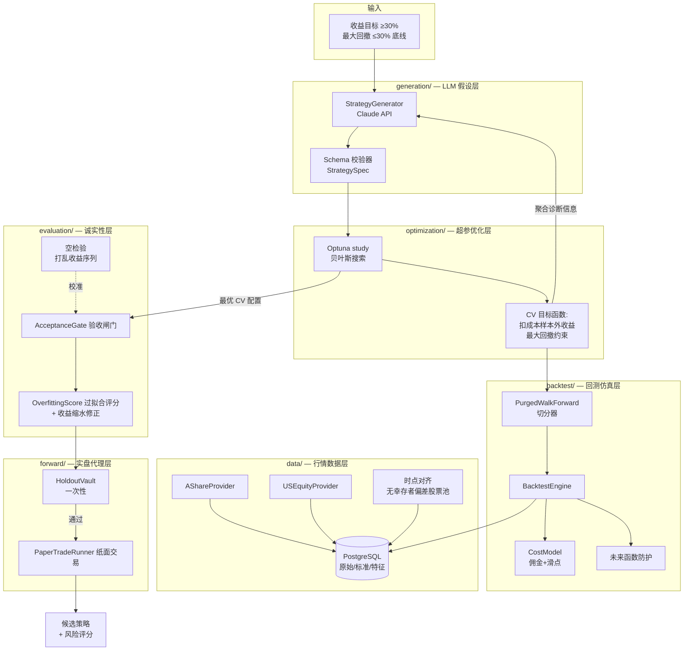
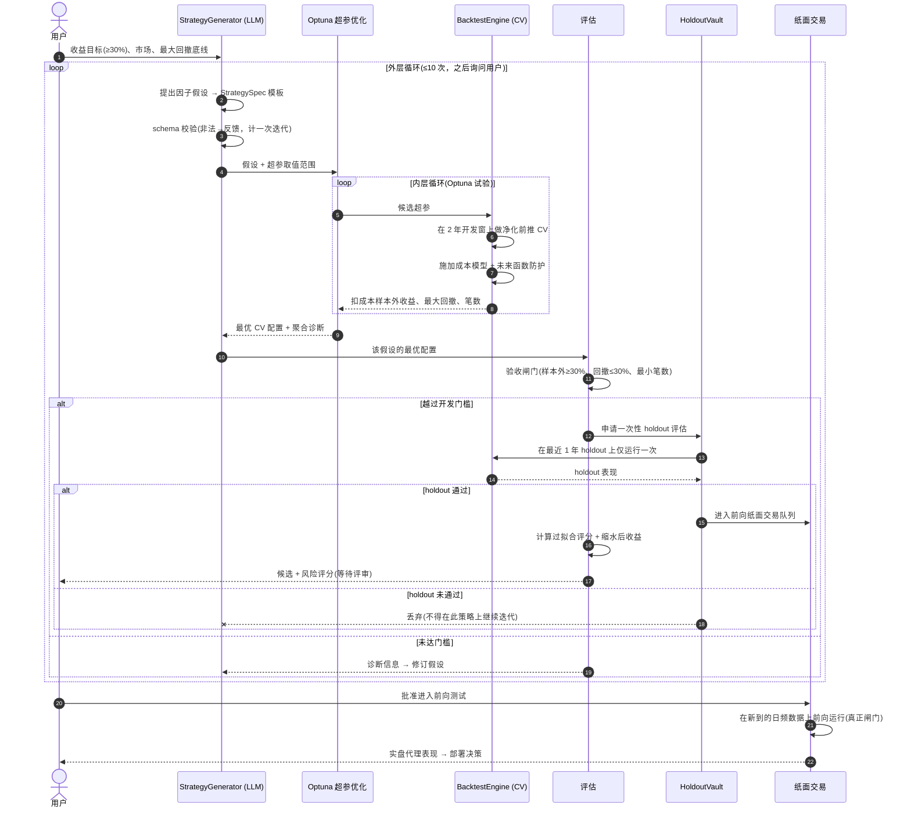
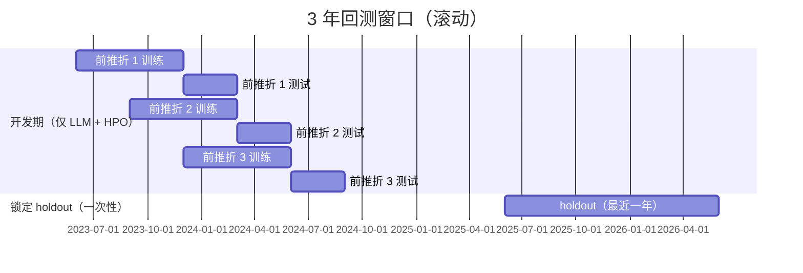

# AI 策略生成闭环 — 设计规格说明书

状态：待评审草稿 · 日期：2026-06-27 · 负责人：quant-agent-team

本文档规定了一套系统：它把"收益目标"转化为经过验证的线性多因子选股策略，核心是一个由 AI 驱动的"假设循环"，外层包裹超参数优化（HPO）。本设计取代 [`solution-overview.md`](../../solution-overview.md) 中关于辅助 KPI 的旧框架，并细化 [`current-architecture-draft.md`](../../current-architecture-draft.md) 中的目标架构。

> 说明：本文为英文版 [`2026-06-27-ai-strategy-generation-loop-design.md`](2026-06-27-ai-strategy-generation-loop-design.md) 的中文对照版，供业务伙伴评审使用；如两版出现歧义，以英文版为准。代码标识符（类名、字段名）保留英文。

---

## 1. 目标与非目标

### 1.1 目标
1. **生成高收益策略。** 主验收门槛：**扣除成本后、样本外测得的年化收益 ≥ 30%。** 翻倍（约 100% 年化）属于"乐于看到但不作保证"的延伸结果，而非工程目标。
2. **支持两个市场：** A 股与美股，本阶段**仅使用量价数据**。
3. **只回测近期：** 仅使用**滚动 3 年窗口**，不做全历史回测。

### 1.2 唯一保留的约束
所有辅助性绩效 KPI（胜率下限、夏普下限等）**全部取消**。唯一保留的硬性底线是**最大回撤 ≤ 30%**，作为防止策略"数学上必然爆仓"的生存性护栏。

### 1.3 有效性闸门（不是 KPI——是不可妥协的正确性要求）
以下不是绩效目标，也不能被配置关掉。它们是"让报告出来的数字可信"的前提：
- 交易成本（佣金 + 滑点），必须建模，且非零。
- 无幸存者偏差的、时点对齐（point-in-time）的股票池。
- 无未来函数 / 无数据泄漏。
- 最小成交笔数，以保证统计意义。
- 优化数据与验证数据严格隔离。

### 1.4 本阶段非目标
- 不做实盘下单（仅出信号，人工手动交易）。
- 美股不做基本面/事件因子（仅量价 → 技术类因子集）。
- 不做机器学习排序模型（先做线性合成；ML 明确推迟到后续阶段）。
- 不做全历史回测。

---

## 2. 诚实的预期管理（请在看图之前阅读）

本系统的核心机制——不断搜索假设与超参数，直到某个组合越过收益门槛——**正是量化研究者自欺欺人的典型方式。** 每一次搜索尝试，都会把数据中的信息"泄漏"进最终被选中的策略里。若不加约束，这个循环会**稳定地产出一个数字，而这个数字在实盘中无法存活。**

因此本设计把**过拟合当作头号对手**，而非脚注。三道相互独立、强度递增的防线：

1. **净化式（purged）前推交叉验证**——开发阶段中，优化器只在样本外折上被评分。
2. **锁定的一次性 holdout**——每个策略只能动用一次；失败即丢弃，绝不在其上继续迭代。
3. **前向纸面交易（paper trading）**——唯一真正的证明，因为 3 年历史无法验证 30%+ 的量级主张。

一个纯多头、仅量价的多因子组合，单凭自身很难做到净收益 30%。要达到这个水平，现实中的杠杆来自**集中持仓、提高换手、向小盘倾斜**——每一项都会抬高风险与过拟合暴露。系统会主动暴露这些取舍，而不是把它们藏在一个好看的收益数字背后。

---

## 3. 系统架构



### 3.1 各模块职责

| 模块 | 职责 | 相对现状的关键变化 |
|---|---|---|
| `data/` | 采集 A 股 + 美股量价；维护时点对齐、无幸存者偏差股票池 | 新增 `USEquityProvider` 作为主源（非 yfinance 兜底）；新增时点对齐股票池；`raw_market_daily` 增加 `market` 区分字段 |
| `backtest/` | 含成本、未来函数防护、净化前推切分器的确定性仿真 | 重构 `backtest_runner.py`；强制非零 `CostModel`；新增 `PurgedWalkForward` 切分器 |
| `optimization/` | 用 Optuna 针对 CV 目标函数调超参 | **新模块** |
| `generation/` | LLM 以 schema 合法的 `StrategySpec` 模板提出因子假设 | **新模块** |
| `evaluation/` | 验收闸门、过拟合评分、收益缩水、空检验 | 扩展 `evaluation.py`；门槛来自请求参数而非硬编码 |
| `forward/` | 锁定 holdout 仓 + 前向纸面交易 | **新模块** |

---

## 4. 端到端工作流



### 4.1 3 年窗口的切分



开发窗（最早约 2 年）是 LLM 与 Optuna **唯一**能看到的数据。最近约 1 年作为锁定 holdout，留作"未来表现"的最佳代理。前推折采用**净化**（剔除标签窗口与测试折重叠的训练样本）与**禁运期 embargo**（每个测试折之后留一段间隔），以防止数据泄漏。

---

## 5. 详细技术设计

### 5.1 策略表示（`generation/`、`models.py`）

一个策略被拆为**假设**（LLM 负责，定性）与**超参**（HPO 负责，数值）。

```python
@dataclass
class FactorHypothesis:
    market: Literal["cn", "us"]
    factors: list[FactorDef]          # 3–8 个因子；强制简约上限
    combination: Literal["linear_zscore"]   # 本阶段固定
    sector_neutral: bool
    holding_horizon: Literal["short", "medium"]  # 映射到调仓族

@dataclass
class FactorDef:
    name: str                          # 如 "momentum_20d"、"reversal_5d"
    source_field: str                  # 必须能经 dependency_registry 解析
    direction: Literal["long_high", "long_low"]

@dataclass
class HyperParamSpace:
    factor_weights: WeightRange        # 各因子权重边界
    top_n: IntRange                    # 持仓数量
    lookbacks: dict[str, IntRange]     # 各因子回看窗口
    rebalance_days: IntRange
    entry_threshold: FloatRange
```

LLM 输出一个 `FactorHypothesis` + `HyperParamSpace`；在 HPO 运行前，两者都要对照上述 dataclass 校验。**非法输出会被拒绝并以错误形式反馈**（消耗一次外层迭代），绝不静默纠偏。

### 5.2 因子打分（线性合成）

对每个调仓日 `t`，在时点对齐的股票池上：
1. 仅用 `t` 时点可得的数据计算各因子值（强制未来函数防护）。
2. 对每个因子做**截面 z-score**（若 `sector_neutral` 则在行业内）。
3. 合成分 = Σ(权重ᵢ × zᵢ)，按 `direction` 调整方向。
4. 排序；取前 `N`；等权（仓位沿用现有 `position_rules`）。

监控因子相关性；高度共线（|ρ| > 0.9）的因子触发诊断告警，反馈给 LLM 以剔除或正交化。

### 5.3 回测引擎（`backtest/`）

对 `backtest_runner.py` 的重构：

- **CostModel（强制非零默认）：** 每次开/平仓都扣除 `commission_bps` + `slippage_bps`，按市场区分（A 股与美股不同）。默认值保守且非零，确保任何调用方都不会静默拿到零成本（虚幻）结果。
- **未来函数防护：** 包装层断言——在日期 `t` 读取的任何特征只能来自 `trade_date ≤ t` 的行。单测会注入未来数据并断言其不可达。
- **PurgedWalkForward 切分器：** 在开发窗上产出带净化 + 禁运期的 (训练, 测试) 索引对。
- **输出：** 逐笔成交日志 + 各折样本外指标（扣成本收益、最大回撤、笔数、换手、集中度）。

### 5.4 优化（`optimization/`）

- **引擎：** Optuna（TPE/贝叶斯）。每个 `FactorHypothesis` 一个 study。
- **目标函数：** 前推各折扣成本样本外收益的均值；任一折最大回撤 > 30% → 硬惩罚；笔数低于下限 → 硬惩罚。
- **简约性：** 限制超参维度；每个 study 限定试验预算。
- **记账：** 记录总试验次数，向下游传递，用于收益缩水（多重检验）修正。

### 5.5 评估与诚实性层（`evaluation/`）

- **AcceptanceGate（验收闸门）：** 开发阶段通过需满足样本外收益 ≥ 30%（扣成本）、最大回撤 ≤ 30%、笔数 ≥ 下限。门槛来自请求对象——**无硬编码模块默认值**（修正现 `evaluation.py` 行为）。
- **OverfittingScore（过拟合评分，0–1，越高越危险）**，综合：
  - 开发 vs holdout 的收益衰减，
  - 越过门槛所用的外层 LLM 迭代次数，
  - Optuna 总试验次数，
  - 超参维度，
  - 笔数（越低越危险），
  - 组合集中度（持仓过少 / 单一权重过高越危险）。
- **缩水后收益：** 报告的收益/夏普会按总试验次数做缩水（多重检验修正）。原始数字绝不单独出现，必须与缩水数字并列。
- **空检验（null test）：** 周期性地在打乱/随机化的收益序列上运行**整个**循环。健康的流水线在噪声上几乎不会产出"通过"的策略；若在噪声上通过率偏高，说明闸门太松、必须收紧。这是系统对自身误发现率（false-discovery rate）的自审。

### 5.6 holdout 纪律与前向测试（`forward/`）

- **HoldoutVault：** 掌管锁定的 1 年 holdout。越过开发门槛的策略**只能**做一次 holdout 评估。通过 → 进前向队列。**未通过 → 丢弃；循环不得在 holdout 失败后继续迭代**（那样会把 holdout 变成训练数据）。仓位记录每一次动用；当累计动用超过预算，holdout 置信度被标记为衰减，窗口须随新数据滚动前移。
- **PaperTradeRunner：** 在新入库的日频数据上前向运行已接受的候选，跟踪实盘代理表现。这是替代所有被取消的审批 KPI 的闸门——在它前向赢得之前，任何东西都不被称为"盈利"。

### 5.7 数据层（`data/`）

- `AShareProvider`、`USEquityProvider`——**仅量价**，写入 `raw_market_daily`，新增 `market` 列（`cn`/`us`）。
- **时点对齐、无幸存者偏差股票池**（`UNI`）：历史成分股归属，含已退市/失败的标的。这是工作量最大、重要性最高的数据任务；没有它，每次回测都向上偏。
- `strategy_data_sync` 成为**硬闸门**：任何未解析依赖，会在回测前抛出列出缺失来源的 `MissingDependencyError`。

---

## 6. 验收标准

| # | 标准 | 验证方式 |
|---|---|---|
| 1 | LLM 输出要么 schema 合法，要么被拒并反馈 | 喂入畸形假设；断言被拒 + 迭代计数 +1 |
| 2 | 回测默认施加非零成本 | 同一 spec，开成本 vs 强制零成本 → 开成本收益 ≤ 零成本 |
| 3 | 无未来函数 | 注入未来行；断言引擎无法读取 |
| 4 | CV 已净化 + 禁运 | 重叠标签测试；断言已从训练折剔除 |
| 5 | HPO 优化样本外而非样本内 | 确认目标函数只读测试折 |
| 6 | holdout 仅一次 | 对同一策略第二次调用 holdout → 报错 |
| 7 | 最大回撤底线生效 | 回测回撤 35% 的策略 → 被拒 |
| 8 | 缩水数字始终伴随原始数字 | 报告同时含两个字段 |
| 9 | 空检验极少通过 | 在打乱数据上跑 N 次；通过率低于阈值 |
| 10 | 缺数据快速失败 | 需未入库字段的 spec → `MissingDependencyError` 而非 SQL 报错 |
| 11 | 无幸存者偏差股票池 | 回测在其历史窗内包含一个已知退市标的 |

---

## 7. 失败处理

| 失败 | 行为 |
|---|---|
| LLM 返回非法 spec | 拒绝，反馈 schema 错误，消耗一次外层迭代 |
| 缺少所需数据 | 回测前抛 `MissingDependencyError` |
| 数据源故障 | 有界重试/退避；结构化失败记入数据质量报告（而非仅打印） |
| 外层循环达 10 次仍未越过门槛 | 询问用户继续还是停止 |
| 策略 holdout 失败 | 丢弃；不迭代 |
| holdout 动用预算超限 | 标记置信度衰减；滚动前移窗口 |
| Optuna study 找不到可行配置 | 报告不可行性，并把诊断反馈给 LLM |

---

## 8. 测试策略

- **单元：** 成本模型计算；z-score/排序；未来函数防护；净化 CV 切分正确性；holdout 一次性约束；过拟合评分单调性。
- **性质/统计：** 注入了**已知** edge 的合成序列 → 流水线能恢复它；纯噪声序列 → 流水线拒绝它（即空检验，纳入 CI）。
- **集成：** 在小型固定股票池 + 日期范围、固定随机种子上跑完整循环，断言端到端产出候选并完成风险评分。
- **CI：** GitHub Actions 在每个 PR 上运行上述项，作为必需检查。

---

## 9. 风险与待定项

| 风险 | 缓解 / 状态 |
|---|---|
| 仅量价的美股池上 30% 净收益难以达到 | 诚实标注（§2）；暴露杠杆来源（集中/换手/小盘）及其成本；首批结果后或需分市场设门槛 |
| 美股无幸存者偏差股票池难以获取 | 列为头号数据任务；若美股时点数据延误，阶段可先做 A 股 |
| LLM 只会提出广为人知（已被套利殆尽）的因子 | 由诊断驱动修订；不假设新颖性——价值在于结构化搜索 + 诚实验证，而非凭空 alpha |
| 多次搜索耗尽 holdout | 动用预算 + 滚动窗口 + 前向测试作为最终裁决 |
| 3 年 = 单一市场状态 | 接受此约束；以前向纸面交易作为补偿性控制 |

### 9.1 分阶段
1. **阶段 1：** 数据层（先 A 股）+ 回测重构（成本、未来函数防护、净化前推）+ 评估诚实性层。
2. **阶段 2：** Optuna HPO + 线性合成打分 + 验收闸门，在固定假设上跑通端到端。
3. **阶段 3：** LLM 生成外层循环 + 过拟合评分 + 空检验。
4. **阶段 4：** holdout 仓 + 前向纸面交易；加入美股市场；（更后）ML 排序模型。

---

## 10. 结论

本设计让该循环在产出真正盈利策略上拥有**现实中最好的机会**，同时对"哪些结果是真的"保持**诚实**。它的构造确保：当它报告一个 30%+ 策略时，这个数字已经挺过了成本、幸存者偏差修正、净化交叉验证、一次性 holdout、多重检验缩水，以及——在投入任何资金之前——前向纸面交易。如果你伙伴的方法是真的，本系统会确认它；如果某一次运行只是走运，本系统会在它让你蒙受损失之前抓住它。
